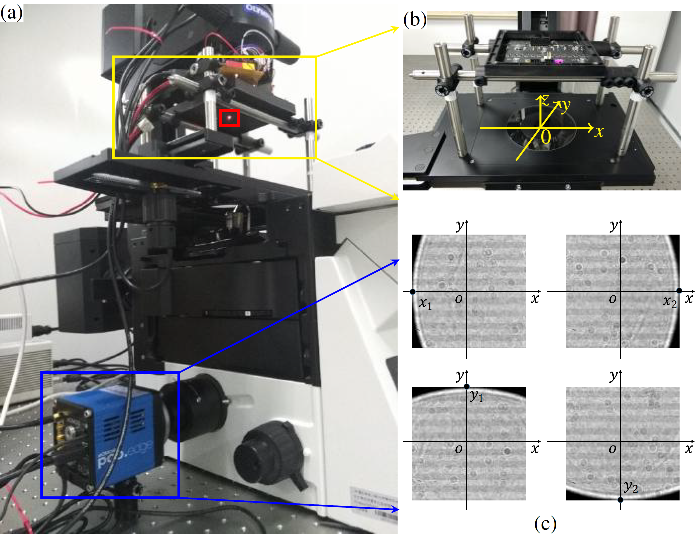
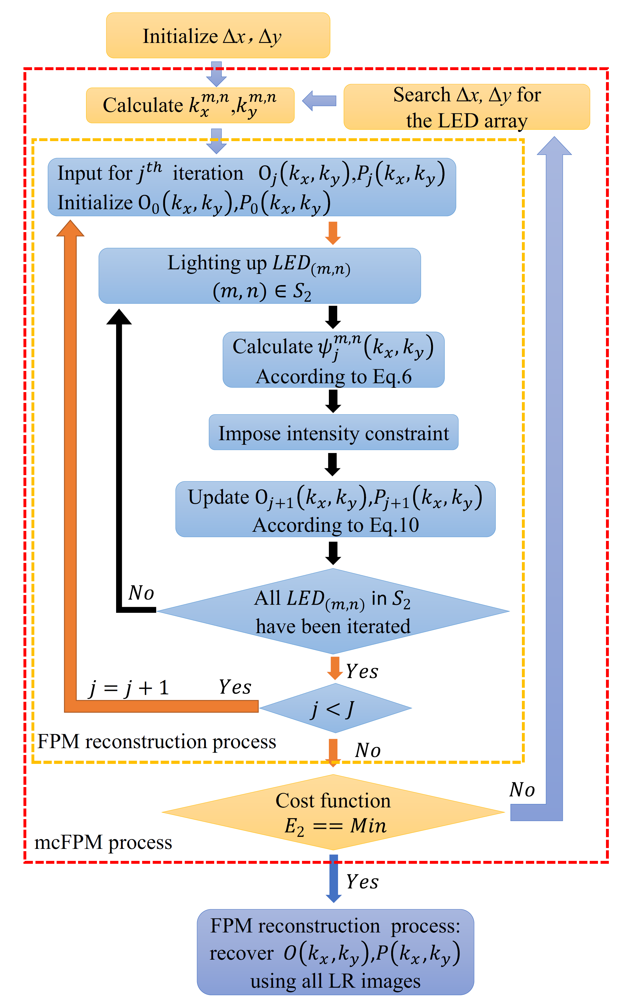
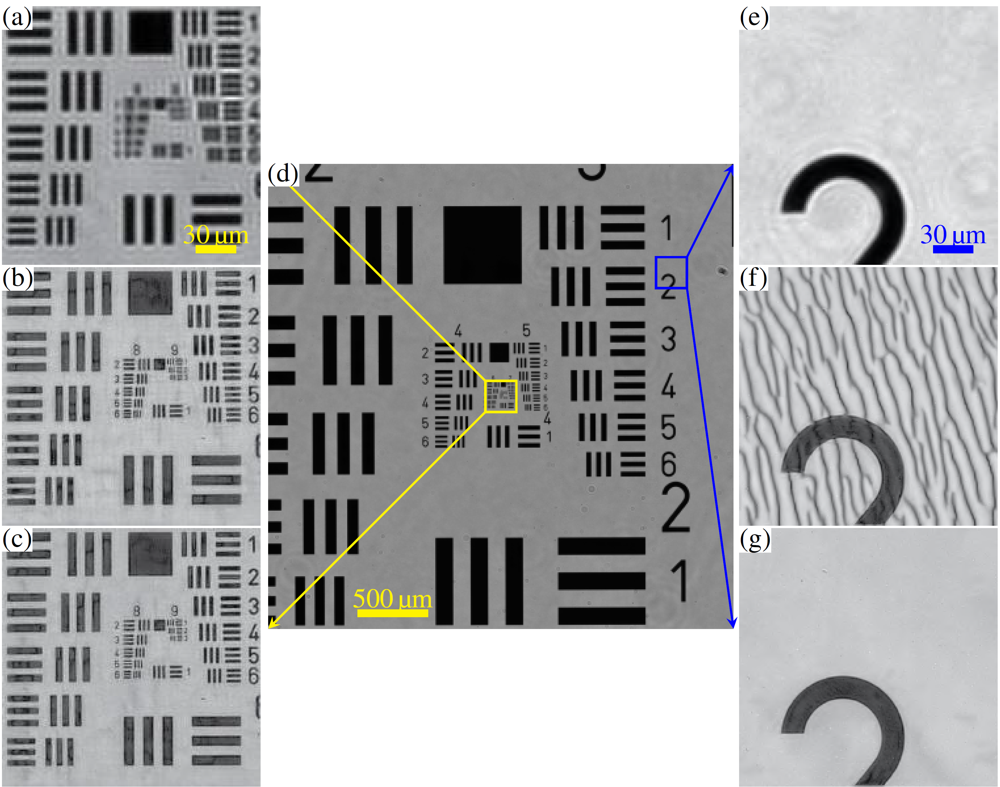
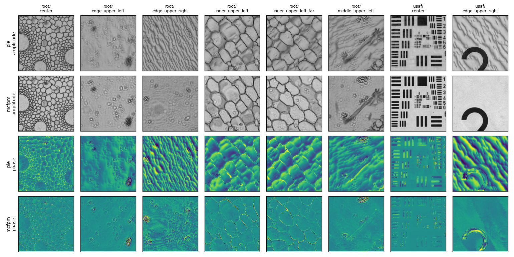

<h2 class="section-title"> Fast and robust misalignment correction of FPM</h2>
<h5 class="pubname"><a href="https://doi.org/10.1364/OE.26.023661">Optics Express</a> 26(18), 23661-23674 (2018)</h5>
<nav class="text-center" style="width: 100%">
  <a href="" class="author">Ao Zhou1,</a>
  <a href="" class="author">Wei Wang1,</a>
  <a href="https://ni-chen.github.io/" class="author">Ni Chen1,2,*,</a>
  <a href="https://www.eee.hku.hk/~elam/" class="author">Edmund Y. Lam3,</a>
  <a href="http://oeqelab.snu.ac.kr/PROF" class="author">Byoungho Lee2,</a>
  <a href="https://ni-chen.github.io/" class="author">Guohai Situ1</a>
</nav>

1 Shanghai Institute of Optics and Fine Mechanics, Chinese Academy of Sciences &nbsp;
2 Seoul National University &nbsp;
3 The University of Hong Kong

 

## Abstract

Fourier ptychographic microscopy (FPM) is a newly developed computational imaging technique that can provide gigapixel images with both high resolution (HR) and wide field of view (FOV). However, there are two possible reasons for position misalignment, which induce a degradation of the reconstructed image. The first one is the position misalignment of the LED array, which can largely be eliminated during the experimental system building process. The more important one is the segment-dependent position misalignment. Note that, this segment-dependent positional misalignment still exists, even after we correct the central coordinates of every small segment. In this paper, we carefully analyze this segment-dependent misalignment and find that this global shift matters more, compared with the rotational misalignments. According to this fact, we propose a robust and fast method to correct the two factors of position misalignment of the FPM, termed as misalignment correction for the FPM misalignment correction (mcFPM). Although different regions in the FOV have different sensitivities to the position misalignment, the experimental results show that the mcFPM is robust with respect to the elimination of each region. Compared with the state-of-the-art methods, the mcFPM is much faster.

## Framework

    

Fig. 1: The experimental setup (a) with the installation manual of the LED array on the microscope (b), and the adjust method of the central LED (c) along the optical axis, and the flow chart of the mcFPM (right figure).

## Results in the paper

Fig. 2: Experimental results of a USAF resolution target. Two segments (a) and (e), which are the enlargement of the parts within the yellow and blue box in the original captured image (d), and their corresponding reconstructions using the conventional FPM without position correction (b) and (f), and the proposed mcFPM (c) and (g).

## Reconstruction comparisons

The same measurements are reconstructed with conventional FPM (PIE) and with mcFPM, by the Python implementation in this repository using the default settings in `data/_template`.

*Data: our own FPM setup. 4× / 0.1 NA objective, 629.7 nm LEDs, 17 × 17 LEDs at 4 mm pitch, 113.5 mm below the sample, PCO.edge 4.2 camera (6.5 µm pixels). Segments of 128 × 128 pixels (200 × 200 for the root centre), reconstructed at 4× the sampling.*

### All segments

Each column is one segment, named after where it lies on the sensor in the raw frames (row 0 at the top); the rows are the amplitude and phase of each method.

<table class="summary-comparison">
  <tbody>
    <tr><td></td></tr>
  </tbody>
</table>

Away from the centre, conventional FPM leaves stripes in the amplitude and a strong low-frequency pattern in the phase; after mcFPM's shift correction both are gone (`root/edge_upper_left` is the exception on the PIE side, see the notes below). The figure compares the two methods as they were run, and they differ in more than the geometry: PIE rounds every LED's spectrum position to a whole pixel and runs nine sweeps, while the final mcFPM reconstruction runs two. That is why the two centre segments, where mcFPM finds almost no shift, still differ in phase. The table below isolates the geometry.

**Reproduce:** `python tools/run_all.py --methods pie mcfpm`, then `python tools/summarize_results.py --wide --refit 9 --output docs/img/comparison_pie_mcfpm.png`. The measurements are in `data/` of the repository.

## Code

<a href="https://github.com/Ni-Chen/Misalignment-Correction-FPM"> Ni-Chen/Misalignment-Correction-FPM</a>: the Python implementation (`src/fpm`) and the measurements.

## Bibtex


<pre>
@article{Zhou2018OE,
  title   = {Fast and robust misalignment correction of {F}ourier ptychographic microscopy for full field of view reconstruction},
  author  = {Ao Zhou and Wei Wang and Ni Chen* and Edmund Y. Lam and Byoungho Lee and Guohai Situ},
  journal = {Optics Express},
  year    = {2018},
  volume  = {26},
  number  = {18},
  pages   = {23661-23674},
  month   = {Aug.},
  doi     = {10.1364/oe.26.023661},
}
</pre>


 
